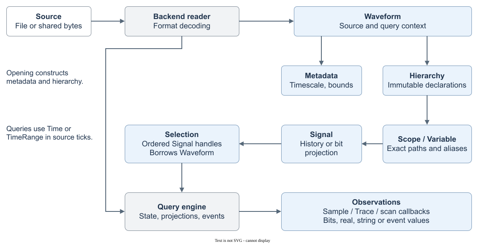

# ondas

A read-only Rust library for waveform analysis across VCD, FST, GHW, WDB, FSDB, SHM and WLF.



## Usage

```toml
[dependencies]
ondas = "1"
```

Public contracts and runnable examples live in Rustdoc under `src/`. See the [released API reference](https://docs.rs/ondas) for the published crate. `waveform-model.md` explains the reasons for the common model.

## Cargo features

No Cargo features are enabled by default. VCD, FST, GHW and WDB are built in, also with `default-features = false`. SDK-backed readers use optional Cargo features with the same names as their reader IDs. They need a local SDK at build time and runtime.

```toml
[dependencies]
ondas = { version = "1", features = ["fsdb-lib"] }
```

## Readers

| Reader | Format | Implementation | Design and limits |
| --- | --- | --- | --- |
| `vcd-native` | VCD | Built-in Rust parser | `vcd-reader.md` |
| `fst-lib` | FST | Published `fst-reader` decoder | `fst-reader.md` |
| `ghw-native` | GHW | Built-in Rust parser | `ghw-reader.md` |
| `wdb-native` | WDB | Built-in Rust parser | `wdb-reader.md` |
| `fsdb-lib` | FSDB | Optional Verdi Reader SDK; file input | `fsdb-reader.md` |
| `shm-lib` | SHM | Optional Xcelium reader; directory input | `shm-reader.md` |
| `wlf-lib` | WLF | Optional Questa SDK; file input | `wlf-reader.md` |

A native feature can make the executable depend on its SDK before Rust starts. This also affects applications that read another format. Each reader document explains its deployment constraints.

## Development

Contributor entry points are `dev` and `justfile`. `AGENTS.md` gives repository rules. `development-workflow.md` explains hooks, required checks and environment limits. `fixture-conformance.md` explains independent evidence. Benchmark interpretation belongs in `benchmark-methodology.md`.

Licensed under Apache License 2.0.
