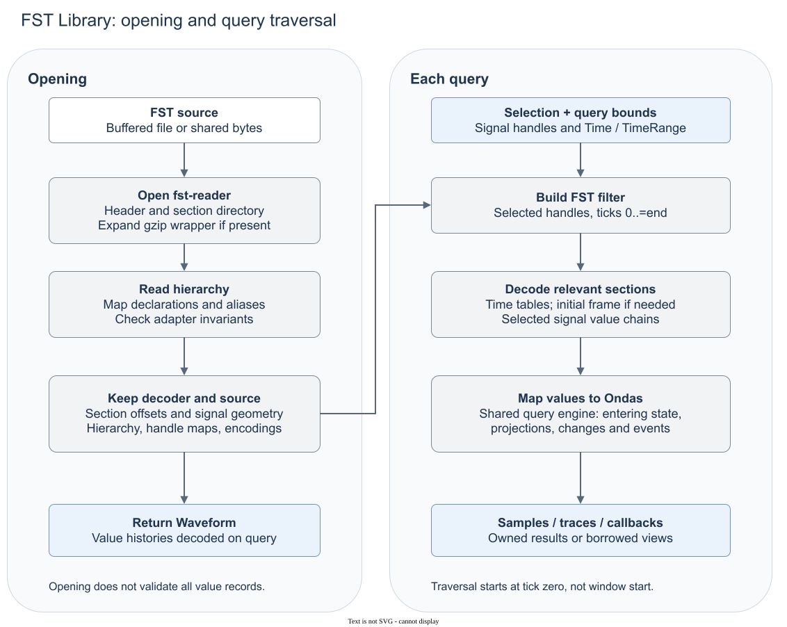

# FST sections, prefix reads and decoder limits

`src/backends/fst.rs` uses the published decoder pinned in `Cargo.toml`. There is no local decoder patch.

## Section access is not point lookup

Opening reads geometry, the section directory and compressed hierarchy. It does not read all value payloads. Successful opening therefore does not validate every later value. Ondas does not request the decoder's optional global time table. An outer whole-file gzip wrapper is expanded into memory. Ordinary file input uses buffered reads.

Stateful reads filter from tick zero through the requested end. A section frame cannot establish every entering value. Variable-length strings can have no initial frame value. Reading only the requested window could turn known state into Missing. Reusing a selection of source signals retains grouping, not decoded histories. Later queries start another traversal.

Within a section, the decoder can load selected value chains before it delivers their changes. It can also decompress a full frame for a small selection. `Break` cannot undo that work. Selected-slot state does not bound decompression memory. The directory and temporary offset/time tables do not form a retained history cache.

Candidate-only scans can skip sections before the window. They need no entering state. They still decode and validate selected chains in overlapping sections. Frames, redundant writes and discarded slice bits can produce extra candidates. These scans have different costs and validation coverage from stateful reads. Both must meet the candidate contract.

## Preserve uncertainty at the decoder boundary

Initial frames and event changes use the same callback shape. At the first recorded tick, an event callback can be initialization or an occurrence. The adapter cannot distinguish them. It keeps the observed callback. It does not infer meaning from payloads or remove all first-tick events. Blackout metadata cannot reconstruct hidden circuit activity.

Enum mappings require decoded keys that match whole stored values. The adapter does not pad, reverse or infer keys from labels. The published decoder can leave label escapes undecoded. The adapter preserves this spelling. Interpretation metadata requires declaration evidence. Observed values and type-name guesses are insufficient.

Some malformed inputs and unsupported decoder cases panic in release builds. Ondas does not contain these panics. Its hierarchy and value checks do not make the upstream parser hardened. An unfinished gzip-wrapper report indicates a decoder-state failure. It does not prove malformed data, establish live-file support or promise a successful retry.
