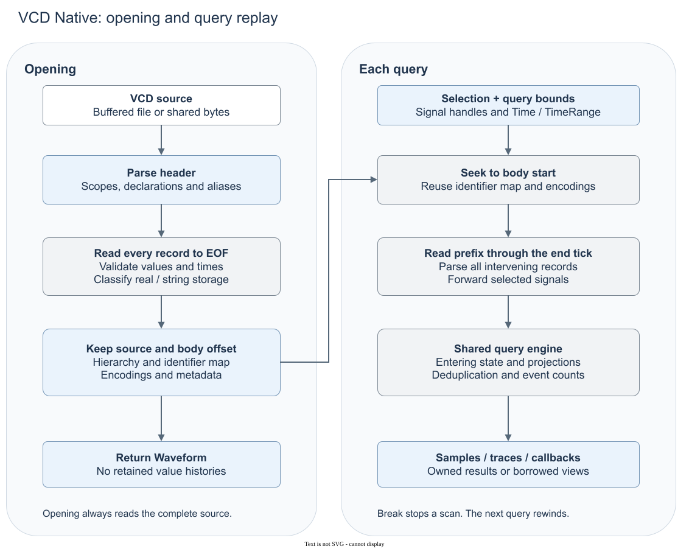

# VCD validation and replay

`src/backends/vcd.rs` defines parsing and replay. The diagram shows the serial path without cached state. Parallel paths use the same engine for completed ticks.

## Opening settles more than syntax

Opening validates the whole body before it publishes handles. This also determines storage. Real declarations with only string records become string signals, also when the text looks numeric. Mixed real/string histories fail. Header-only parsing could expose handles with an encoding that later records invalidate.

Value digits are validated before selection filtering or truncation. Removing high bits from an over-width value does not make invalid digits acceptable. A narrow query therefore does not imply that opening ignored malformed unselected text.

Large Unix files can validate independent chunks in parallel. Each chunk starts at a timestamp boundary. Selected prefix summaries can also use parallel work. Uncertain boundaries use the serial path. Full-range queries can buffer bounded batches of selected records before delivery in order. These are temporary parsing buffers, not retained histories or a seek index. File and byte inputs can have different costs.

## A checkpoint needs parser context

The identifier map cannot seek to a tick. Without reusable state, a late read must establish selected state from the body. A selection can retain its last completed state and one bounded boundary checkpoint. The checkpoint needs dump-block context as well as a byte offset and timestamp.

A query context can need events at the absolute preceding tick. Session reuse therefore needs a position before the session start. A snapshot after that boundary would lose those counts. Earlier requests can use the boundary checkpoint or replay. Stopped and failed traversals discard reusable state. Source code defines cache and parallel-buffer limits.

## Compatibility choices

Ordinary event records count even at the first tick. Records inside dump blocks are snapshots, not occurrences. Removing every first-tick event would lose recorded occurrences. Counting every checkpoint would invent triggers. A tick with both checkpoint and event records cannot establish physical multiplicity. A resume record also cannot identify a hidden transition time.

Declaration merging uses source spelling and parent identity. Equal logical paths are insufficient. The parser interprets attached range-like text only under its width and escaping rules. An escaped identifier can contain literal brackets. Public lookup must not repeat these syntax guesses.

The parser accepts integer-valued decimal timestamps. It also accepts the Migen closed declaration list that enters dumpvars without enddefinitions. These are specific compatibility choices. They do not establish general EVCD support. Crate Rustdoc defines supported syntax and rejection categories. `fixture-conformance.md` explains conformance evidence.
