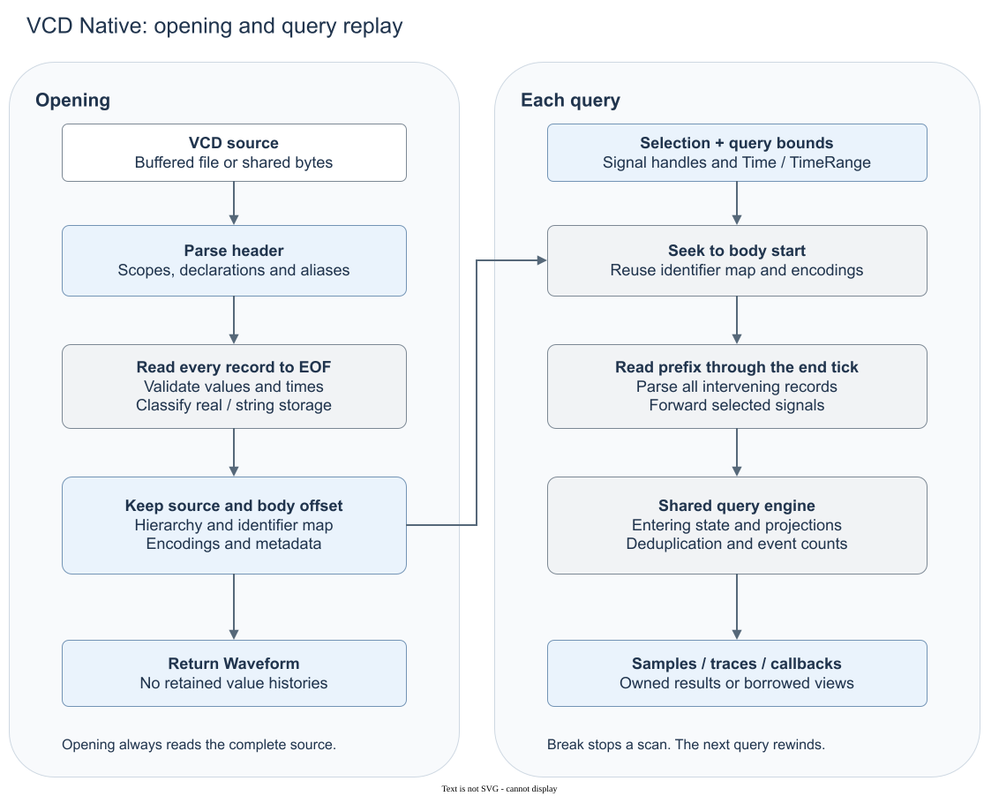

# VCD validation and replay

`src/backends/vcd.rs` defines parsing and replay. The diagram shows the serial path without cached state. Parallel paths use the same engine for completed ticks.

## Opening settles more than syntax

Opening validates the whole body before it publishes handles. This also determines storage. Real declarations with only string records become string signals, also when the text looks numeric. Mixed real/string histories fail. Header-only parsing could expose handles with an encoding that later records invalidate.

Value digits are validated before selection filtering or truncation. Removing high bits from an over-width value does not make invalid digits acceptable. A narrow query therefore does not imply that opening ignored malformed unselected text.

Large Unix files can validate independent chunks in parallel. Each chunk starts at a timestamp boundary. Selected prefix summaries can also use parallel work. Uncertain boundaries use the serial path. Full-range queries can buffer bounded batches of selected records before delivery in order. These are temporary parsing buffers, not retained histories.

## A position index avoids replaying the prefix

A file opening that uses chunked validation also retains a bounded index of validated record positions: per signal, the source offsets and ticks of its records. The index stores no values, no source bytes and no query state, and it never spans opens. Inputs without that indexed read path, including byte input, small files, one-worker environments and metadata-only opening, keep the chronological path and retain no index. Dump-block ranges are retained so a resume never starts inside one. Event records inside dump blocks stay excluded because they are snapshots.

A late point or prefix decodes the last indexed record of each selected signal and proves its `changed_at` from earlier records. The proof compares tick-final values, so an excursion that returns to the entering value does not advance the time. The read keeps the chronological replay when a value, a selection or the transient records exceed the private budgets, when the merge peak would exceed them, when an allocation fails, when the proof runs out, or when the next record lies in a dump block. A retained record is decoded again from the source with the same encoding and validation rules. Opening still validates the whole body, and source files must remain unchanged.

A sparse selection reads its indexed records in tick order instead of walking every intervening record. The byte offset is the consumed-record boundary, so a checkpoint inside a tick never repeats an already consumed record. The traversal reuses one bounded source window and one decoded scratch, including across a payload, its identifier and adjacent records, and it decides eligibility before the first callback. A record whose raw token exceeds the traversal working-state policy, a dense selection, an unsupported encoding and a request whose merged records would not save reads keep the walk. That policy is a backend working-state bound, not an input limit: the walk still reads such a record. An IO failure keeps its typed error, and a source inconsistency after delivery is an error, never a restart.

An explicit-time batch can seed its requested window from a validated entering state only when the index, the selection and the resource policy support it; otherwise it keeps the body start. It still reads one fresh chronological traversal and does not reuse an earlier selection replay.

A candidate-time request can visit indexed base activity directly. That covers every change time of a normalized scan and can include extra activity; the public candidate contract allows this superset. A slice or composition passes its whole bases. Without the index the generic scan supplies the candidate times.

## A checkpoint needs parser context

Without an index entry, the identifier map cannot seek to a tick. Without reusable state, a late read must establish selected state from the index or the body. A selection can retain its last completed state and one bounded boundary checkpoint. The checkpoint needs dump-block context as well as a byte offset and timestamp.

A query context can need events at the absolute preceding tick. Session reuse therefore needs a position before the session start. A snapshot after that boundary would lose those counts. Earlier requests can use the boundary checkpoint or replay. Stopped and failed traversals discard reusable state. Source code defines cache and parallel-buffer limits.

## Compatibility choices

Ordinary event records count even at the first tick. Records inside dump blocks are snapshots, not occurrences. Removing every first-tick event would lose recorded occurrences. Counting every checkpoint would invent triggers. A tick with both checkpoint and event records cannot establish physical multiplicity. A resume record also cannot identify a hidden transition time.

Declaration merging uses source spelling and parent identity. Equal logical paths are insufficient. The parser interprets attached range-like text only under its width and escaping rules. An escaped identifier can contain literal brackets. Public lookup must not repeat these syntax guesses.

The parser accepts integer-valued decimal timestamps. It also accepts the Migen closed declaration list that enters dumpvars without enddefinitions. These are specific compatibility choices. They do not establish general EVCD support. Crate Rustdoc defines supported syntax and rejection categories. `fixture-conformance.md` explains conformance evidence.
